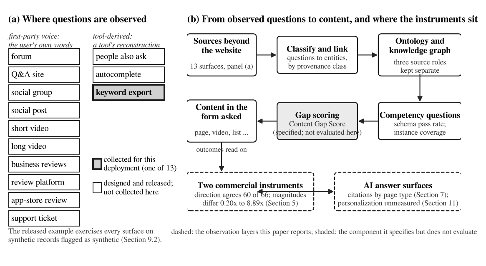

<p align="center">
  
</p>

<h1 align="center">User First Intelligence</h1>

<p align="center">
  Find the content gaps an industry has from what people ask, wherever they ask it,<br>
  not from what a keyword tool counts.
</p>

<p align="center">
  <a href="https://github.com/VenkataPagadalaGIT/ufi/actions/workflows/ci.yml"></a>
  <a href="tests/"></a>
  <a href="tests/"></a>
  <a href="pyproject.toml"></a>
  <a href="https://github.com/astral-sh/ruff"></a>
  <a href="https://mypy-lang.org/"></a>
  <a href="LICENSE"></a>
  <a href="pyproject.toml"></a>
  <a href="paper/"></a>
  <a href="CITATION.cff"></a>
</p>

---

## What this is

`ufi` is the reference implementation of **User First Intelligence (UFI)**, a framework for deciding what an organization should publish.

The premise: people say what they want to know in many places that are not a search box: forum threads, question sites, video comments, reviews, support tickets, social groups. Keyword-volume tools see the fraction of that demand that reaches a search engine in a countable phrasing, and they are good for *direction* but not for *magnitude* (the released data shows two major tools agreeing on which section of a site is bigger in 60 of 66 pairs while differing on the size by 0.2x to 8.9x). So UFI goes to where the questions are:

1. **Collect** user questions across thirteen demand surfaces, beyond the website.
2. **Classify and link** them to the entities of an industry held under an **ontology**.
3. **Hold** the result in a **knowledge graph** whose structure, coverage and demand sources are kept in separate roles, so a competitor's coverage can never pose as user demand.
4. **Ask** that graph **competency questions**, executably, and report schema pass rate and instance coverage separately.
5. **Score** where the organization does not answer, with the **Content Gap Score**, and treat the form the answer should take as something to measure.

**What is validated and what is not, stated up front.** The pipeline, the guardrails, the ontology tooling and the reproducibility artifacts are implemented and tested. The Content Gap Score itself is a specification: no published study has yet tested whether it predicts anything. This package exists so that such a study is possible, and so that any claim made with it is checkable.

## Quick start

```bash
git clone https://github.com/VenkataPagadalaGIT/ufi
cd ufi
pip install -e ".[dev]"      # includes the RDF extras (rdflib, pyshacl, owlready2)
ufi --version

cd examples/nanp
python make_demo_inputs.py   # deterministic synthetic inputs, no network, no model
python build_example.py      # full run in a couple of seconds
```

The example runs over the 66 US geographic area codes in its registry extract and prints, among other things:

```
reasoner: HermiT (owlready2), consistent=True, 66 individuals reclassified by entailment
SHACL: 70 focus nodes, 0 violations, vacuous=False
schema pass rate:   4/5 (80%) of declared questions the ontology can express
instance coverage:  70.4% mean over supported questions; 2/4 answered for every subject
demand: 177 records, 177 links, first-party share 0.00, synthetic share 1.00
manifest digest 4a7596a507cbd5f8  judgments 1386 (calls 0, cache hits 1188)
```

> **What is real and what is not.** The ontology and the area-code facts are real. The demand records, reported volumes and retrieved-result evidence are **synthetic**, generated with a fixed seed. Every synthetic record is flagged, the flag propagates, and the run reports a first-party demand share of 0.00 so that nothing computed from it can be mistaken for an observation about users. That is the example working correctly.

## The score

```
prior(e) = β·rel(e) + (1 − β)·dem(e)
CGS(e)   = prior(e) · (1 − own(e)) · [ α·(1 − cov_K(e)) + (1 − α)·mean_q(1 − ans(q,e)) ]
```

| Term | Meaning | Source class |
|---|---|---|
| `rel(e)` | topic-sensitive PageRank over the structure graph, rank-normalized | structure |
| `dem(e)` | rank-normalized count of user questions linked to `e` | demand |
| `own(e)` | the organization's own coverage, graded {0, ½, 1} | coverage |
| `cov_K(e)` | mean of the same grade over the competitor set `K` | coverage |
| `ans(q,e)` | whether the web answers competency question `q` about `e` | answerability |

`α` moves weight between the two deficits; `β` between structure and demand. The first bracket term is the **instance gap** (nobody covers this entity), the second the **schema gap** (nobody answers this question about it). They are reported separately because they call for different content. Reported search volume is not an input. Full specification: Appendix B of the [paper](paper/).

## Where the questions come from

Thirteen demand surfaces, grouped by whether they carry a user's own words or a tool's reconstruction of demand. A run prints which surfaces returned rows, so a demand term computed from nothing is visible rather than implied.

| First-party voice (the user's own words) | Tool-derived |
|---|---|
| forum · Q&A site · social group · social post · short video · long video · business reviews · review platform · app-store review · support ticket | people also ask · autocomplete · keyword export |

Adding a surface is one adapter class. Collection itself (API keys, rate limits, terms of service) belongs to the deployment, not the package. Details: [docs/DEMAND_SURFACES.md](docs/DEMAND_SURFACES.md).

## Command line

| Command | What it does |
|---|---|
| `ufi validate ontology.yaml` | check the ontology and its competency questions before scoring |
| `ufi owl ontology.yaml -o nanp.owl` | export OWL 2 and SHACL shapes |
| `ufi cq ontology.yaml --graph kg.nt` | run competency questions against a graph; print both rates |
| `ufi freeze queries.txt -o frozen.json` | hash the evaluation query set before launch |
| `ufi lock -o params.lock.json` | pin α, β and damping before scoring |
| `ufi verify frozen.json` | confirm a frozen set is intact |
| `ufi manifest out/manifest.json` | print a run's reproducibility digest |

Scoring is a library call rather than a subcommand, because a run needs evidence suppliers wired to a deployment's own crawls; `examples/nanp/build_example.py` is the template to copy. Full reference: [docs/CLI.md](docs/CLI.md).

## How it is built

```
src/ufi/
├── types.py        core value types; SourceClass puts structure / coverage / demand on provenance
├── ontology.py     ontology spec, competency questions, validation, OWL + SHACL export
├── cq.py           executable competency questions: chain validation, SPARQL generation, two rates
├── graph.py        the knowledge graph, with the source-class separation enforced
├── demand.py       thirteen demand-surface adapters, entity linking, coverage report
├── judge.py        graders for the three subjective inputs; judgments cached with their context
├── score.py        the Content Gap Score and its components
├── baselines.py    the practitioner baselines, on the same candidate list
├── rdf.py          RDF serialization, HermiT reasoning, SHACL validation, materialization
├── provenance.py   query freezing, parameter locking, the run manifest
├── pipeline.py     end to end: ontology + graph + demand + judgments → ranked gaps
└── cli.py          the commands above
```

Design decisions and the reasons for them: [docs/ARCHITECTURE.md](docs/ARCHITECTURE.md).

## Guardrails: five things the package makes hard to get wrong

- **Structure and coverage stay separate.** Only structure-sourced triples reach the relatedness graph, so well-covered entities cannot rank as gaps.
- **A demand term with nothing behind it is visible.** The coverage report lists every designed surface, including the ones that produced nothing; synthetic records are excluded from the first-party share.
- **A query universe defined after the outcome is marked.** `freeze_queries()` writes the evaluation set with a hash and refuses to overwrite.
- **Judgments are cached with their context.** Subject, question, rubric identifier and evidence digest, not just a grade; changing the rubric misses the cache.
- **An empty validation is not a clean one.** `rdf.validate()` refuses to call a run conformant when it had nothing to check; `rdf.reason()` reports how many assertions were inferred.

Why each exists, and what an adversarial review of the package found: [docs/GUARDRAILS.md](docs/GUARDRAILS.md).

## Reproducibility

Every run writes a manifest whose digest covers the ontology, the graph, the judgment cache, the parameters and the frozen query set, and deliberately excludes timestamps and the grader's model string. The frozen artifacts behind the paper are committed:

| Artifact | Path | Digest |
|---|---|---|
| frozen query set (924 queries over 66 codes) | `examples/nanp/out/frozen_queries.json` | `f05ce279942be5f8` |
| parameter lock (α = 0.5, β = 0.5, damping = 0.85) | `examples/nanp/out/parameters.lock.json` | `7290a2235d8de05f` |
| run manifest | `examples/nanp/out/manifest.json` | |

Details: [docs/REPRODUCIBILITY.md](docs/REPRODUCIBILITY.md).

## The paper and its data

**User First Intelligence: Ontology-Driven Content Gap Discovery from Multi-Source Industry Knowledge Graphs Beyond Search Volume**, preprint v4.8, 12 October 2026: [`paper/`](paper/) (PDF, DOCX, source bundle).

The paper's measurement result, two commercial instruments read on twelve sections of one domain on one day, ships as data plus the script that prints every statistic quoted: [`data/instrument_divergence/`](data/instrument_divergence/).

```bash
cd data/instrument_divergence && python analyze.py
```

## Known limitations

- `rel` is strongly correlated with node degree on sparse graphs (about 0.8 on the example); check it on your own graph before trusting the prior.
- The three-level rubric is coarse; half credit covers a wide range.
- `ans` takes the best of several verbalizations, which rewards the easiest phrasing.
- The entity linker is longest-match over aliases: adequate for identifiers, not for ambiguous names.
- The NANP ontology is a nine-class sketch, not yet a resource-grade vocabulary; terms are minted under `urn:ufi:` because no persistent namespace has been registered, and the package has no DOI yet.

## Development

```bash
make install     # editable install with dev tools
make all         # lint, types, tests with coverage, the example, digest verification
```

CI runs the same on every push across Python 3.10 to 3.13, and additionally checks that the worked example is deterministic across two runs and that `analyze.py` still reproduces the paper's statistics. `pre-commit install` enables the same lint and format hooks locally.

## Contributing, citing, licence

Contributions are welcome; see [CONTRIBUTING.md](CONTRIBUTING.md) and the [CHANGELOG](CHANGELOG.md). To cite, use [`CITATION.cff`](CITATION.cff). Apache 2.0 for the code; the ontology and the bundled area-code dataset are CC BY 4.0.
